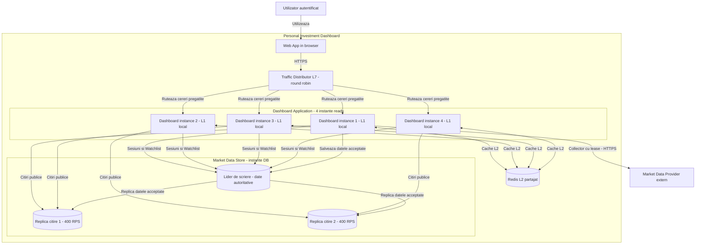
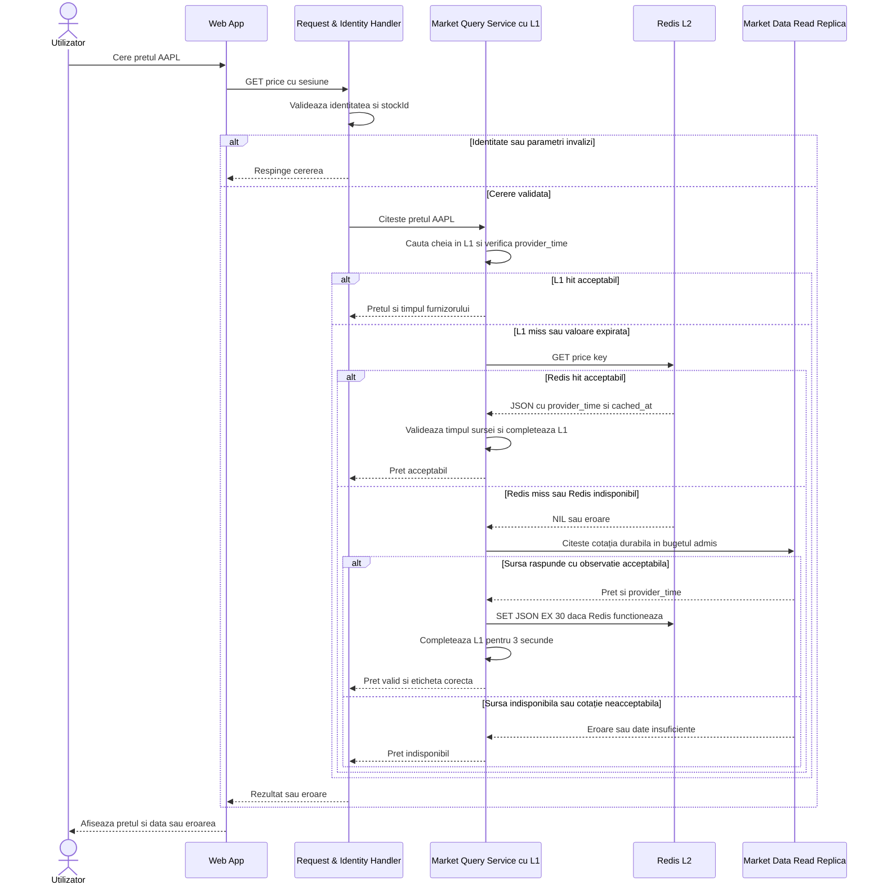
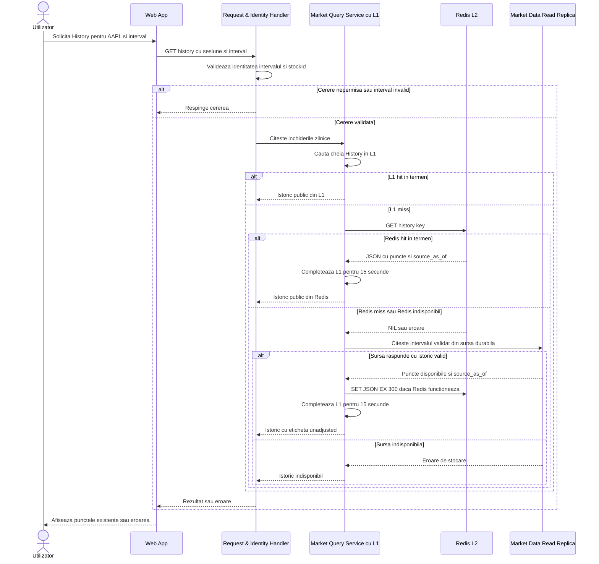

# Laboratorul 4 — Scalarea traseului de citire al Dashboard-ului

**Disciplina:** Proiectarea sistemelor informatice  
**Student:** Marjina Lilian  
**Grupa:** InfA-241  
**Proiect:** Personal Investment Dashboard

## 1. Scop și cerințe de proiectare

Scopul laboratorului este scalarea traseului de citire și proiectarea cache-ului în două niveluri (memorie locală L1 și Redis L2), fără a modifica scopul aplicației: un utilizator autentificat poate consulta Overview, Search, Filter, Stock price și History, iar Watchlist rămâne privat. Datele despre piață vin dintr-un singur **Market Data Provider**, sunt validate de **Market Data Collector** și persistate în **Dashboard Database**. Nicio citire din browser nu contactează direct furnizorul.

### Legătura cu laboratoarele anterioare

Păstrăm regulile din laboratoarele 2 și 3: Stock price are ținta **p50 ≤ 100 ms, p95 ≤ 500 ms**; celelalte citiri au **p95 ≤ 2 s** și termen-limită de **2 s**. Într-o sesiune de piață normală, un preț cu vârsta sursei de până la **15 min** este acceptat cu marcajul fluxului întârziat; între **15 și 20 min** este etichetat explicit „Delayed”; peste **20 min** este **Unavailable**. Sunt păstrate și regulile pentru deschidere/închidere, fără a confunda ora furnizorului cu ora memorării în cache. Datele Watchlist nu sunt partajate între utilizatori și modificările confirmate trebuie văzute la următoarea citire.

**Schimbarea față de laboratorul 3:** același container logic **Dashboard Application** are acum mai multe instanțe, există un **Traffic Distributor L7**, un cache **L1 local** în fiecare instanță și un cache **Redis L2** comun, iar componenta de stocare a datelor de piață este desfășurată cu un lider și replici de citire. Componentele `Request & Identity Handler`, `Market Query Service`, `Watchlist Service` și `Market Data Collector` rămân responsabilități ale aplicației, nu microservicii independente. Instanțele auxiliare/replicile sunt topologie de rulare, nu sisteme noi în System Context.

Laboratorul 2 a calculat, la 3.000 de utilizatori, **792 RPS total** în regim stabil și **1.030 RPS total** la vârful de deschidere (marja sa de 10% inclusă). **Acest laborator dimensionează separat numai clasa Stock price**, pentru care enunțul impune 600 RPS și o marjă nouă de 20%. Nu pretindem că dimensionarea clasei Stock price demonstrează automat capacitatea pentru totalul de 1.030 RPS sau pentru scenariul de 30.000 de utilizatori; acelea necesită teste suplimentare.

## 2. Scalarea Dashboard Application și distribuirea traficului

### 2.1 Calculul numărului minim de instanțe

Date oferite în enunț:

- **600** cereri Stock price/s la 3.000 de utilizatori;
- **20%** marjă de capacitate;
- **250 RPS** Stock price per instanță Dashboard pregătită, cu ținta de latență respectată;
- trebuie menținută ținta chiar dacă **o instanță se oprește**.

```text
Ținta cu marjă = 600 × (1 + 0,20) = 720 RPS
Instanțe necesare după o oprire = ceil(720 / 250) = 3
Număr pregătit inițial = 3 + 1 = 4 instanțe

Capacitate normală = 4 × 250 = 1.000 RPS
Capacitate după oprirea uneia = 3 × 250 = 750 RPS ≥ 720 RPS
```

| Instanțe inițial | După oprirea uneia | Capacitate rămasă | Concluzie |
| ---: | ---: | ---: | --- |
| 3 | 2 | 500 RPS | Insuficient |
| **4** | **3** | **750 RPS** | **Minimum corect** |
| 5 | 4 | 1.000 RPS | Rezervă suplimentară, dar nu minimum cerut |

La 4 instanțe, încărcarea medie la ținta de 720 RPS este **180 RPS/instanță**. După oprirea uneia devine **240 RPS/instanță**, sub limita măsurată de 250. Aceste valori sunt pentru cereri de preț cu cost comparabil, nu pentru un amestec arbitrar de History și Filter.

### 2.2 Distribuitor și politică de selecție

Aleg un **Traffic Distributor de nivel L7**, cu selecție **round robin** între instanțele *ready*. Cererile HTTP sunt similare ca efort în clasa Stock price, iar distribuția pe fiecare cerere evită dependența de IP-ul utilizatorului. L7 permite identificarea rutelor HTTP și observabilitate pe tip de cerere. Distribuitorul scoate o instanță din selecție dacă aceasta nu mai este pregătită să deservească cereri.

**Limită principală:** round robin distribuie numărul de cereri, **nu garantează sarcină CPU egală**. O cerere History costisitoare sau o instanță care încetinește poate dezechilibra încărcarea; se urmăresc p95, erorile, RPS și capacitatea efectivă. Distribuitorul însuși trebuie disponibilizat redundant în producție, deoarece un singur proxy constituie punct unic de defectare.

**HPA:** păstrăm același profil de resurse ca în testul menționat în enunț; definim minimum **4 replici pregătite** și permitem extinderea după măsurarea încărcării. Scalarea automată nu înlocuiește instanța suplimentară deja disponibilă în momentul defectării: pornirea unei instanțe durează timp.

### 2.3 Starea care supraviețuiește unei opriri

| Stare | Amplasare | De ce |
| --- | --- | --- |
| Sesiuni, identitatea și revocarea | Stocare comună autoritativă | Orice instanță poate valida o sesiune după rerutare. Token-ul nu devine identitate doar pentru că se află în browser. |
| Watchlist, proprietar, versiuni și modificări confirmate | Liderul stocării autoritative, cu mecanism de recuperare durabilă | Nu se pierde o modificare confirmată; citirea următoare nu poate folosi o replică privată întârziată. |
| Cotații acceptate, timpul furnizorului, istoric, calendar | Market Data Store durabil | Cache-ul poate fi refăcut și vârsta sursei rămâne verificabilă. |
| Cursor de sincronizare, lease/generation, retry, acreditări furnizor | Stare de coordonare durabilă și secret server-side | Colectorul reia în siguranță fără sincronizări concurente sau chei expuse. |
| L1 local, conexiuni deschise, calcule temporare | Memoria instanței Dashboard | Pot fi pierdute; cererea se reia prin instanța rămasă și datele autoritative. |
| Redis L2 | Cache partajat, neautoritativ | Redis poate fi gol sau indisponibil fără pierdere definitivă a datelor. |

Pentru a nu multiplica apelurile către furnizor, doar un **Market Data Collector** deține lease-ul pentru un lot la un moment dat, chiar dacă există patru instanțe ale aplicației.

## 3. Container — scalarea aplicației și a stocării

O replică de citire poate deservi **400 RPS** de citiri publice Stock price. Liderul de scriere **nu este inclus** în capacitatea citirilor publice obișnuite.

```text
Citiri publice de dimensionat = 720 RPS
Capacitatea unei replici = 400 RPS
Replici necesare = ceil(720 / 400) = 2
Capacitate de citire = 2 × 400 = 800 RPS
```

Se pornește de la **un lider de scriere + două replici de citire**. Repartizarea la ținta de 720 RPS este aproximativ **360 RPS pe replică**, dacă ambele sunt sănătoase. **Nu** presupunem niciun cache hit. Două replici nu garantează însă 720 RPS după pierderea uneia: ar rămâne numai 400 RPS. Dacă impunem și toleranța la pierderea unei replici de citire, este necesară **a treia replică** (`(3 − 1) × 400 = 800 RPS`). Cerința explicită de supraviețuire la o oprire privește instanța Dashboard, nu replica bazei de date; alegem două replici ca minimum și raportăm acest risc.

Replicile pot avea **lag**. `Market Query Service` verifică `provider_time`, versiunea/validitatea datelor și starea sesiunii la fiecare rezultat; o replică întârziată nu primește automat eticheta „Fresh”. Când replica nu are o observație acceptabilă, rezultatul este indisponibil conform politicii, nu un preț inventat. **Watchlist, sesiuni și modificări confirmate** folosesc calea autoritativă, nu replicile potențial întârziate. Scrierile colectorului ajung la lider, apoi sunt propagate replicilor. Promovarea unui lider nou și garanțiile de recuperare a scrierilor confirmate necesită configurare/test separat; simpla existență a replicilor nu garantează disponibilitatea la orice defectare.

### Container View actualizat



**Interpretarea diagramei:** fiecare instanță include aceleași componente interne ca în laboratorul 3; săgețile spre replici arată trasee posibile, nu o obligație de a folosi mereu o singură replică fixă. La oprirea unei instanțe, altă instanță poate dobândi lease-ul Collector-ului din stocarea comună; cheia furnizorului rămâne configurată doar pe server. Legăturile către lider pentru sesiuni/Watchlist sunt reprezentate simplificat. Cache-urile nu devin surse de adevăr.

## 4. Cache — contracte pentru citiri publice

Selectăm **Stock price** și **History**. Ambele rezultate sunt publice *ca informație de piață*, dar cererea HTTP rămâne autentificată. Validarea identității are loc înainte de răspuns, inclusiv dacă există cache hit. În cache nu intră `user_id`, token-uri, sesiuni sau lista privată Watchlist.

**Politica aleasă:** TTL simplu (nu stale-while-revalidate). Niciun cache hit nu prelungește limita de prospețime a sursei. Când o intrare expiră sau nu mai este acceptabilă după verificarea sesiunii și a timpului furnizorului, ea este tratată ca *miss*; după un eșec al sursei nu returnăm o intrare expirată drept actuală.

| Decizie | Stock price | History |
| --- | --- | --- |
| Cheie Redis L2 | `price:v1:NASDAQ:AAPL:USD` | `history:v1:NASDAQ:AAPL:USD:2026-10-01:2026-10-31:daily:unadjusted` |
| Date care schimbă cheia | Identificator stabil al instrumentului, piață, monedă și versiunea formatului/politicii | Același instrument, piață, monedă, intervalul cerut, rezoluția zilnică, tipul *unadjusted* și versiunea |
| Valoare | Preț, monedă, `provider_time`, `session_date`, `cached_at`, identificator, versiune | Punctele de închidere existente, datele efective, `source_as_of`, `cached_at`, indicator *unadjusted* și versiune |
| Sursă durabilă | Cotația acceptată + calendar + instrument din Market Data Store | Închiderile zilnice validate + identitatea instrumentului din Market Data Store |
| TTL L1 local | **3 s** | **15 s** |
| TTL Redis L2 | **30 s** | **300 s** |
| Reguli de actualitate | Revalidează `provider_time` la fiecare citire după politica de 15/20 minute și limitele de sesiune din laboratorul 2 | Închiderile istorice nu „îmbătrânesc” ca prețurile live; intervalul este limitat la fereastra de 7 ani și o corecție sau un nou close impune invalidare/reîncărcare |
| Rezultat la defectare | Dacă L1/Redis nu răspund, încearcă sursa durabilă în limita bugetului; dacă și aceasta e indisponibilă, **Preț indisponibil**, fără zero inventat | Dacă L1/Redis nu răspund, citește sursa în limita bugetului; dacă e indisponibilă, **Istoric indisponibil**, nu „0 rezultate” |

**Calcularea TTL-ului efectiv:** durata de 30 s pentru preț este doar plafonul cache-ului, **nu dreptul de a afișa 30 s orice înregistrare**. La orice hit verificăm din nou timpul curent față de `provider_time`, calendarul și fereastra permisă. Nu servim o valoare care tocmai a depășit limita; în perioadele de tranziție a sesiunii verificăm eticheta corectă (`Market closed`, `awaiting delayed quote` etc.). Pentru History, modificările și corecțiile venite de la Collector invalidează cheia prin versionare sau ștergere; dacă invalidarea nu este imediată, poate exista un interval de maximum 300 s până la expirarea TTL-ului L2, ce trebuie măsurat și acceptat explicit ca ipoteză de cache (nu este o garanție de consistență instantanee pentru istoricul public).

**Evitarea supraaglomerării:** la miss, o instanță face *single-flight* pe cheia locală; se limitează concurența globală de citiri spre replici și nu se execută un apel nou la Market Data Provider. Dacă Redis este căzut, traseul continuă prin replicile de citire. Un cache gol este un eveniment de performanță, nu o pierdere de date.

### 4.1 Secvența A — citirea prețului unei acțiuni (Stock price)



**Ipoteze inițiale:** identitatea validă este verificată înainte de folosirea cache-ului; L1 se află în fiecare Dashboard instance; Redis este comun; sursa durabilă este o replică ce poate avea întârziere. Orice hit este revalidat față de timpul furnizorului și calendar, iar o eroare de Redis nu blochează automat citirea din bază. O eroare de bază după un miss produce explicit „Preț indisponibil”. Citirea utilizatorului **nu pornește sincronizarea furnizorului**.

### 4.2 Secvența B — citirea istoricului unei acțiuni (History)



**Ipoteze inițiale:** un interval valid cu **zero puncte** poate fi rezultat corect numai dacă baza confirmă lipsa înregistrărilor; o eroare de stocare nu este mascată ca listă goală. Istoricul reprezintă *daily unadjusted closes*, limitate la șapte ani. La corecții, intrările vechi se invalidează; la eșecul sursei după miss utilizatorul vede „Istoric indisponibil”. Nici History nu solicită furnizorul în traseul de citire.

## 5. Preîncărcarea cache-ului și tratarea defectărilor

Redis poate fi complet gol înainte de deschiderea pieței. În loc să populăm toate instrumentele și toate intervalele istorice, **preîncărcăm un set limitat** de chei publice, selectat din cele mai cerute în ultimele sesiuni:

1. **Maximum 50 de chei Stock price** pentru instrumentele cu cerere mare, de exemplu `NASDAQ:AAPL:USD`. Intrările se creează numai din observații încă acceptabile la momentul citirii; nu convertim prețurile vechi în prețuri „noi”.
2. **Maximum 10 chei History** pentru intervale frecvente (de exemplu ultimele 30 de zile pentru acțiunile urmărite frecvent), cu o limită totală selectată de **10 MB de JSON preîncărcat**.

Se folosește o coadă cu concurență redusă, **maximum 4 citiri simultane** pentru preîncărcare și **maximum 20 de citiri/s agregat**, cu prioritate inferioară traficului utilizatorilor. Aceste valori sunt **politici propuse** pentru laborator, nu cifre măsurate ale bazei. Repetăm preîncărcarea după recuperarea Redis, gradual, cu jitter; nu relansăm toate cheile simultan la deschiderea pieței.

**Fallback fără cache hit:** ținta impusă de 720 RPS trebuie suportată fără presupuneri de hit. Două replici la 400 RPS oferă 800 RPS teoretici pentru citiri publice, iar distribuitorul de interogări aplică un **buget agregat de maximum 720 citiri Stock price/s** spre replici, repartizat către replicile sănătoase fără a depăși **400 RPS pentru fiecare**. Limita se aplică înainte de accesarea bazei și trebuie coordonată între instanțele Dashboard; nu folosim patru limite independente de 720 RPS. Pentru preîncărcare rămân prioritare citirile interactive; dacă ar concura toate pentru aceeași capacitate, încărcarea în avans este suspendată.

Dacă o cerere ajunge în timp ce preîncărcarea e incompletă, se încearcă traseul normal L1 → Redis → replica durabilă. Dacă bugetul disponibil este epuizat, nu așteptăm nelimitat: răspundem cu **„Date temporar indisponibile — reîncercați”**, cu un status de supraîncărcare adecvat, fără a fabrica date și fără a pretinde că cererea a fost acceptabilă. Pentru un History valid se aplică analog bugete și limite proprii, evaluate separat pentru a nu compromite ținta Stock price. Dacă Redis și toate replicile sunt indisponibile, datele devin indisponibile; L1 poate fi folosit numai cât intrarea este încă validă conform politicii sale. Pentru a respecta ținta de disponibilitate din laboratorul 2, defectarea Redis este tolerată prin fallback, dar defectarea tuturor surselor nu este mascată.

**Verificare planificată:** teste cu 720 RPS fără hit în L1/Redis, cu 4 și apoi 3 instanțe Dashboard, cu Redis gol/indisponibil, cu o replică DB întârziată, cu 429/timeout de la furnizor, și cu Watchlist modificat de pe două sesiuni. Raportăm latența p50/p95/p99, cererile corecte finalizate, erorile, lag-ul replicilor, numărul de miss-uri și timpul de refacere a cache-ului. Nu declarăm aceste teste executate.

## 6. Redis — comenzi și rezultate ilustrative

**Tipul demonstrației:** transcrieri **ilustrative, reproductibile**, nu rezultate pretinse ca executate în acest mediu. Într-un terminal cu Redis pornit, `redis-cli PING` trebuie să răspundă `PONG`. Se presupune că cheia demonstrată nu există înainte de primul `GET` (cache gol sau cheie curățată anterior). În aplicația reală, între primul `GET` și `SET`, serviciul citește **Market Data Store** în diagrama de secvență, validează rezultatul și îl serializează. Comenzile de mai jos simulează doar completarea cache-ului.

### 6.1 Cazul Stock price

```console
$ redis-cli PING
PONG
$ redis-cli GET 'price:v1:NASDAQ:AAPL:USD'
(nil)
# Citire reusita din Market Data Store: exemplu didactic, nu cotatie de piata actuala.
$ redis-cli SET 'price:v1:NASDAQ:AAPL:USD' '{"stock_id":"NASDAQ:AAPL","currency":"USD","price":150.25,"provider_time":"2026-11-17T14:30:00Z","session_date":"2026-11-17","cached_at":"2026-11-17T14:31:00Z","version":1}' EX 30
OK
$ redis-cli GET 'price:v1:NASDAQ:AAPL:USD'
"{\"stock_id\":\"NASDAQ:AAPL\",\"currency\":\"USD\",\"price\":150.25,\"provider_time\":\"2026-11-17T14:30:00Z\",\"session_date\":\"2026-11-17\",\"cached_at\":\"2026-11-17T14:31:00Z\",\"version\":1}"
$ redis-cli TTL 'price:v1:NASDAQ:AAPL:USD'
(integer) 29
```

`29` este **o valoare ilustrativă**, nu o garanție; `TTL` poate întoarce alt număr între 0 și 30 în funcție de timpul scurs. `provider_time` reprezintă momentul observației furnizorului; `cached_at` reprezintă momentul introducerii în cache. Exemplul de preț este fictiv și **nu** trebuie prezentat drept cotație efectivă. În aplicație, verificarea calendarului pieței și a vârstei reale se aplică **înaintea** afișării.

### 6.2 Cazul History

```console
$ redis-cli GET 'history:v1:NASDAQ:AAPL:USD:2026-10-01:2026-10-31:daily:unadjusted'
(nil)
# Citire reusita din Market Data Store: doua puncte fictive dintr-un interval demonstrativ.
$ redis-cli SET 'history:v1:NASDAQ:AAPL:USD:2026-10-01:2026-10-31:daily:unadjusted' '{"stock_id":"NASDAQ:AAPL","currency":"USD","from":"2026-10-01","to":"2026-10-31","resolution":"daily","adjustment":"unadjusted","points":[{"date":"2026-10-01","close":151.20},{"date":"2026-10-02","close":152.10}],"source_as_of":"2026-11-01T00:00:00Z","cached_at":"2026-11-17T14:31:00Z","version":1}' EX 300
OK
$ redis-cli GET 'history:v1:NASDAQ:AAPL:USD:2026-10-01:2026-10-31:daily:unadjusted'
"{\"stock_id\":\"NASDAQ:AAPL\",\"currency\":\"USD\",\"from\":\"2026-10-01\",\"to\":\"2026-10-31\",\"resolution\":\"daily\",\"adjustment\":\"unadjusted\",\"points\":[{\"date\":\"2026-10-01\",\"close\":151.20},{\"date\":\"2026-10-02\",\"close\":152.10}],\"source_as_of\":\"2026-11-01T00:00:00Z\",\"cached_at\":\"2026-11-17T14:31:00Z\",\"version\":1}"
$ redis-cli TTL 'history:v1:NASDAQ:AAPL:USD:2026-10-01:2026-10-31:daily:unadjusted'
(integer) 299
```

Rezultatul `299` este ilustrativ. În practică, cheia pentru un interval este completată cu **toate punctele disponibile** pentru acel interval; cele două puncte reprezintă doar un JSON scurt pentru exercițiu. La un rezultat gol verificat, JSON-ul poate avea `"points":[]` cu informația că sursa a fost consultată cu succes; la defectarea bazei nu se memorează fals un rezultat gol.

### 6.3 Persistența și recuperarea Redis

Alegem pentru Redis **cache fără persistență pe disc** (`save ""`, `appendonly no`), în această arhitectură didactică. Redis L2 este o optimizare, nu stochează permanent date unice. La restart poate reveni **complet gol**; datele autoritative și timestamp-urile furnizorului rămân în Market Data Store. Dashboard reconstruiește intrările la cache miss și prin preîncărcarea limitată din secțiunea 5.

Un **TTL Redis** măsoară cât timp mai există cheia în Redis, **nu vârsta observației furnizorului**. O cotație veche de 30 de minute memorată acum 1 secundă poate avea TTL 29 s, dar este deja *Unavailable* ca preț curent în sesiune normală. De aceea verificăm mereu `provider_time`, nu `cached_at` și nu simplul rezultat `TTL`.

## 7. Decizii arhitecturale și verificarea rezultatelor

| Cerință de predare | Unde este rezolvată |
| --- | --- |
| Calcul cu marjă de 20% și oprirea unei instanțe | §2.1 — 720 RPS, 4 instanțe |
| L4/L7, metoda aleasă, motiv și limită | §2.2 — L7 round robin |
| Stare durabilă și stare temporară | §2.3 |
| Container View cu distributor, instanțe Dashboard și DB | §3 — diagramă Mermaid |
| Scalare fără presupuneri de hit | §3 — lider + 2 replici, 800 RPS |
| Contracte cache pentru două citiri publice | §4 — Price și History, fără date private |
| Câte o secvență cu L1 hit, Redis hit, miss și sursă indisponibilă | §4.1 și §4.2 — două diagrame Mermaid |
| Preîncărcare limitată, fallback și efect pentru utilizator | §5 |
| `GET`, `SET ... EX`, `GET`, `TTL`, JSON pentru fiecare caz | §6.1 și §6.2 — transcrieri ilustrative |
| Alegerea persistenței și TTL față de actualitatea sursei | §6.3 |

**Concluzie:** proiectarea propusă acoperă ținta **Stock price de 720 RPS** cu o instanță Dashboard oprită, fără să depindă de un hit în cache, și menține distincția dintre date de piață publice și Watchlist privat. Valorile de capacitate sunt **date și calcule didactice**, nu rezultate ale unui deployment efectiv. Disponibilitatea reală, întârzierea replicilor, fallback-ul și randarea Mermaid necesită verificare în mediul de implementare.


## 8. Verificarea cerințelor

- [x] Este calculată ținta Stock price de 720 RPS, inclusiv marja de 20%.
- [x] Sunt dimensionate 4 instanțe Dashboard pentru funcționarea după oprirea uneia.
- [x] Este aleasă distribuirea L7 round robin, cu motiv și limită.
- [x] Starea durabilă este separată de memoria temporară a instanțelor.
- [x] Diagrama Container arată distribuitorul, instanțele Dashboard, Redis și instanțele bazei de date.
- [x] Sunt definite două contracte cache fără date private, pentru Stock price și History.
- [x] Ambele secvențe conțin L1 hit, Redis hit, citire din sursa durabilă și eșecul sursei.
- [x] Preîncărcarea și fallback-ul au limite și rezultate explicite pentru utilizator.
- [x] Ambele exemple Redis includ `GET`, `SET ... EX`, `GET`, `TTL` și valori JSON.
- [x] Este precizată politica de persistență Redis și diferența dintre TTL și prospețimea sursei.
- [x] Sunt incluse trei diagrame sursă `mermaid` pentru randare pe GitHub.

**Notă de validare:** valorile și rezultatele Redis sunt exemple didactice, nu măsurători efectuate. Diagramele trebuie verificate vizual după publicarea pe GitHub.

## 9. Referințe

1. [Laboratorul 4 — Scalează traseul de citire al Dashboard-ului](https://github.com/marjinalilian/system-design-labs/blob/main/labs/04-read-heavy-request-path/README-ro.md)
2. [Lecture 5 — Horizontal Scaling, Caching, and Availability](https://github.com/marjinalilian/system-design-labs/blob/main/lectures/lecture-05-horizontal-scaling-caching-and-availability.md)
3. [Laboratorul 2 — Cerințe de calitate și estimări](../lab-2/README.md)
4. [Laboratorul 3 — Arhitectura de bază](../lab-3/README.md)
