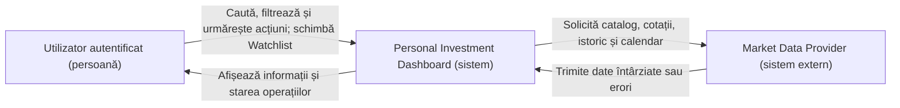
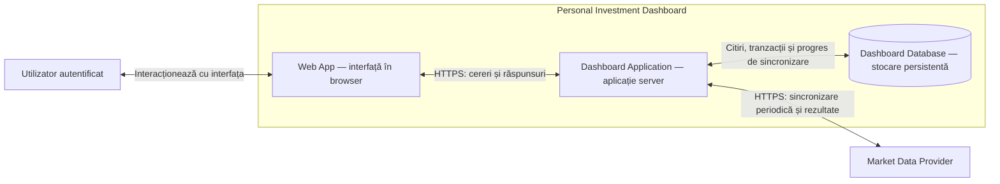
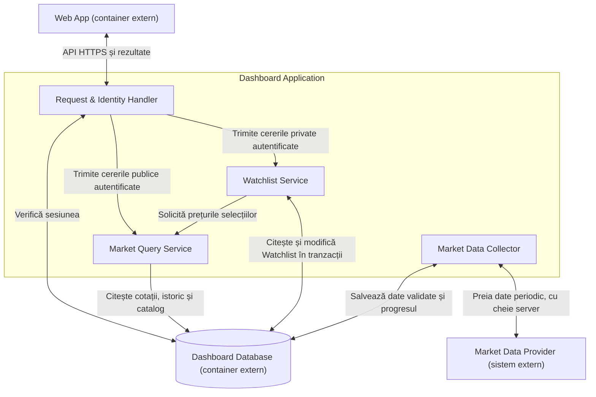
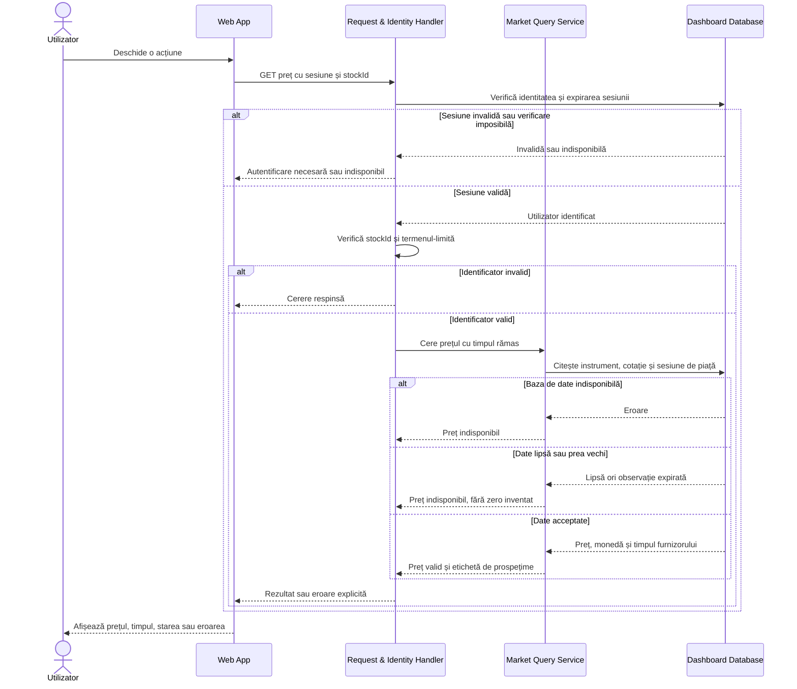
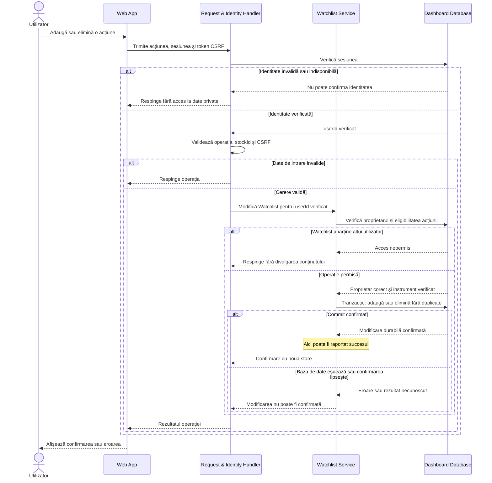

[Uploading README.md…]()
# Laboratorul 3 — Arhitectura de bază a sistemului

**Disciplina:** Proiectarea sistemelor informatice  
**Student:** Marjina Lilian  
**Grupa:** InfA-241  
**Proiect:** Personal Investment Dashboard

## 1. Scop și cerințe de proiectare

Scopul laboratorului este definirea limitelor arhitecturale ale aplicației **Personal Investment Dashboard** folosind trei niveluri C4 (System Context, Container și Component), urmate de trei diagrame de secvență care verifică funcționarea normală și cazurile de eroare.

Aplicația permite unui utilizator autentificat să caute și să filtreze acțiuni, să consulte prețul și istoricul lor și să își administreze un Watchlist privat. Informațiile provin dintr-un singur **Market Data Provider** extern. Nu sunt incluse tranzacționarea, recomandările financiare și notificările în timp real.

### Legătura cu laboratoarele anterioare

| Element | Cerință preluată | Impact asupra arhitecturii |
| --- | --- | --- |
| Funcționalități | Overview, Search, Filter, Stock price, History, Watchlist | Separăm citirile de piață de modificările private. |
| Încărcare | 7.920 cereri/s în regim normal la 30.000 utilizatori | Prețurile se citesc din stocare, nu prin apel individual la furnizor. |
| Vârf de trafic | 10.296 cereri/s cu marjă inclusă | Ingestia are limită de concurență, separat de calea de citire. |
| Latență | p95 ≤ 500 ms pentru Stock price; p95 ≤ 2 s pentru celelalte citiri | Citirile au termen-limită de 2 secunde, inclusiv verificările de sesiune. |
| Prospețime | Furnizor întârziat ~15 min; maxim 20 min în sesiune obișnuită | Folosim timestamp-ul furnizorului, nu momentul salvării în baza de date. |
| Watchlist | Citirea următoare trebuie să reflecte modificarea confirmată | Confirmăm modificarea doar după commit și citim starea autoritativă. |
| Confidențialitate | Nicio citire/modificare reușită între utilizatori diferiți | Identificarea și autorizarea se verifică pe server. |

**Alegere de bază:** o aplicație web în browser, o aplicație server și un depozit de date persistent. Actualizarea datelor de piață rulează în fundal, în cadrul aplicației server. Nu introducem microservicii, broker de mesaje sau cache distribuit fără o nevoie demonstrată.

## 2. System Context — limita sistemului



**Explicație.** Limita sistemului conține întregul Dashboard, fără componente interne. Utilizatorul și furnizorul sunt în afara ei. Dashboard-ul nu transmite furnizorului conținutul Watchlist-ului. Autentificarea este o condiție pentru acces; nu presupunem un furnizor extern de identitate.

## 3. Container — aplicații și stocare



| Container | Responsabilitate | Reguli importante |
| --- | --- | --- |
| **Web App** | Prezintă liste, detalii, istoricul și Watchlist-ul. | Nu accesează direct baza de date sau furnizorul; afișează erorile explicit. |
| **Dashboard Application** | Controlează identitatea, citirile, modificările private și sincronizarea periodică. | Păstrează cheia furnizorului numai pe server; impune termene-limită și permisiuni. |
| **Dashboard Database** | Salvează instrumente, cotații, istoric, Watchlist, sesiuni și progres de sincronizare. | Tranzacții atomice, chei unice, persistență și citiri consistente. |

Această diagramă descrie părți logice de execuție, nu numărul de mașini virtuale sau containere Docker. Datele publice despre piață sunt comune utilizatorilor, în timp ce membrii Watchlist sunt asociați cu identificatorul intern al fiecărui utilizator.

## 4. Component — interiorul Dashboard Application



| Componentă | Rol |
| --- | --- |
| **Request & Identity Handler** | Verifică sesiunea, expirarea, formatul parametrilor și protecția CSRF pentru modificări; transmite identitatea verificată. |
| **Market Query Service** | Realizează Overview, Search, Filter, Stock price și History; validează prospețimea datelor salvate. |
| **Watchlist Service** | Verifică proprietarul, adaugă/elimină instrumente, împiedică duplicatele și asigură citirea modificărilor confirmate. |
| **Market Data Collector** | Execută sincronizări programate, validează răspunsurile furnizorului și salvează atomic datele acceptate și progresul. |

Componentele sunt module **în aceeași Dashboard Application**; nu sunt servicii lansate separat. Calea unei citiri a utilizatorului nu depinde direct de furnizor. Sincronizatorul și cititorul comunică prin datele deja confirmate în baza de date.

## 5. Secvența A — sincronizarea datelor de piață

```mermaid
sequenceDiagram
    participant C as Market Data Collector
    participant DB as Dashboard Database
    participant P as Market Data Provider
    C->>C: Se declanșează sincronizarea programată
    C->>DB: Cere drept de executare și poziția ultimei sincronizări
    DB-->>C: Stare, cursor și moment permis pentru retry
    alt Sincronizarea nu este permisă acum
        Note over C: Nu face apel suplimentar către furnizor
    else Sincronizarea este permisă
        C->>P: Cere un lot folosind cheia păstrată pe server
        alt Timeout sau limitare a cererilor (429)
            P-->>C: Timeout sau răspuns de limitare
            C->>DB: Salvează următorul moment de retry
            Note over C,DB: Datele acceptate anterior rămân nemodificate
        else Răspuns primit
            P-->>C: Lot, timpi ai furnizorului, cursor
            C->>C: Verifică identitatea, valorile, datele și timpii
            alt Lot invalid
                C->>DB: Înregistrează eroarea, fără a avansa cursorul
                Note over C,DB: Nu publică date invalide
            else Lot valid
                C->>DB: Tranzacție: salvează datele și cursorul
                alt Commit reușit
                    DB-->>C: Confirmă salvarea
                    Note over C,DB: Numai acum datele sunt disponibile cititorilor
                else Salvare eșuată sau rezultat incert
                    DB-->>C: Eroare sau lipsa confirmării
                    Note over C: Nu afirmă succes; la reluare verifică progresul
                end
            end
        end
    end
```

**Ipoteze inițiale:** colectorul rulează în fundal la intervale programate, iar acreditările furnizorului sunt disponibile doar pe server. O singură sincronizare poate deține același lot în același timp; cursorul și datele sunt salvate atomic. Se verifică valori pozitive pentru preț, monedă USD, instrument acceptat și timestamp valid. În caz de timeout, 429, lot invalid sau eroare de stocare, informațiile valide anterioare rămân în baza de date, dar pot deveni prea vechi pentru a fi afișate ca preț acceptabil. Răspunsul 429 impune respectarea intervalului `Retry-After`, dacă există.

## 6. Secvența B — citirea prețului unei acțiuni



**Ipoteze inițiale:** utilizatorul poate avea sesiune validă sau expirată; durata totală permisă pentru citire este 2 secunde. **Citirea nu face un apel nou către Market Data Provider.** Se utilizează exclusiv date validate și stocate. În sesiunea normală, o observație cu vârstă până la 15 minute este afișată cu timpul furnizorului și mențiunea fluxului întârziat; între 15 și 20 de minute apare o etichetă evidentă „Delayed”; peste 20 de minute prețul curent devine „Unavailable”. La închiderea pieței se poate afișa separat ultimul preț de închidere confirmat, marcat cu data sesiunii, conform regulilor laboratorului 2. Orice eroare de stocare, timp expirat sau lipsă a informației necesare produce o eroare explicită, nu valoarea zero.

## 7. Secvența C — modificarea unui Watchlist privat



**Ipoteze inițiale:** fiecare utilizator are un Watchlist privat. `userId` este dedus din sesiunea validată pe server și nu este acceptat ca identitate de încredere din browser. Proprietarul este verificat înaintea modificării și în tranzacția de scriere. Nu se pot adăuga instrumente inactive sau neacceptate, dar se pot elimina cele devenite inactive. Repetarea adăugării nu creează duplicate. **Succesul se raportează doar după confirmarea commit-ului.** După aceea, următoarea citire a aceluiași utilizator, inclusiv din altă sesiune, trebuie să arate noua stare sau o schimbare confirmată mai recentă; dacă baza nu poate confirma starea, rezultatul este „Unavailable”, nu o listă învechită prezentată drept actuală.

## 8. Decizii arhitecturale și tratarea defectărilor

| Situație | Decizie |
| --- | --- |
| Furnizorul răspunde lent sau limitează cererile | Colectorul reprogramează sincronizarea și păstrează înregistrările valide existente. |
| Furnizorul trimite preț negativ, instrument neacceptat sau timestamp invalid | Lotul este respins înainte de publicare. |
| Prețul stocat a expirat | Utilizatorul vede indisponibil, fără apel sincron la furnizor. |
| Stocarea nu este disponibilă | Citirile dependente eșuează explicit; modificările nu sunt declarate reușite. |
| Un utilizator cere Watchlist-ul altei persoane | Acces respins, fără divulgarea datelor private. |
| O modificare a fost confirmată | Următoarea citire se face din starea autoritativă și reflectă schimbarea. |
| Crește volumul de citiri | Se scalează capacitatea aplicației și a bazei pe baza testelor, fără a introduce din start servicii suplimentare. |

**Compromis ales:** sincronizarea în fundal reduce dependența imediată a citirilor de furnizor, însă un preț absent poate rămâne indisponibil până la următoarea sincronizare validă. Aceasta este o alegere intenționată, favorabilă latenței previzibile și separării responsabilităților.

## 9. Verificarea cerințelor

- [x] Diagrama System Context arată un singur sistem și actorii externi.
- [x] Diagrama Container descrie aplicațiile și stocarea minim necesare.
- [x] Diagrama Component deschide numai Dashboard Application.
- [x] Există trei diagrame de secvență, cu participanți consecvenți.
- [x] Fluxurile acoperă succes, respingere și defectare.
- [x] Sunt precizate ipotezele pentru fiecare secvență.
- [x] Sunt documentate sincronizarea, prospețimea, autorizarea și commit-ul.
- [x] Sunt incluse șase blocuri sursă `mermaid` compatibile cu formatul GitHub Markdown.

## 10. Referințe

1. [Laboratorul 3 — Desenează limita Dashboard-ului](https://github.com/metreniuk/system-design-labs/blob/main/labs/03-baseline-architecture/README-ro.md)
2. [Lecture 4 — Architecture Decomposition and Data Flows](https://github.com/metreniuk/system-design-labs/blob/main/lectures/lecture-04-architecture-decomposition-and-data-flows.md)
3. Laboratoarele 1 și 2 — Personal Investment Dashboard (scope și ținte de calitate/volum).
