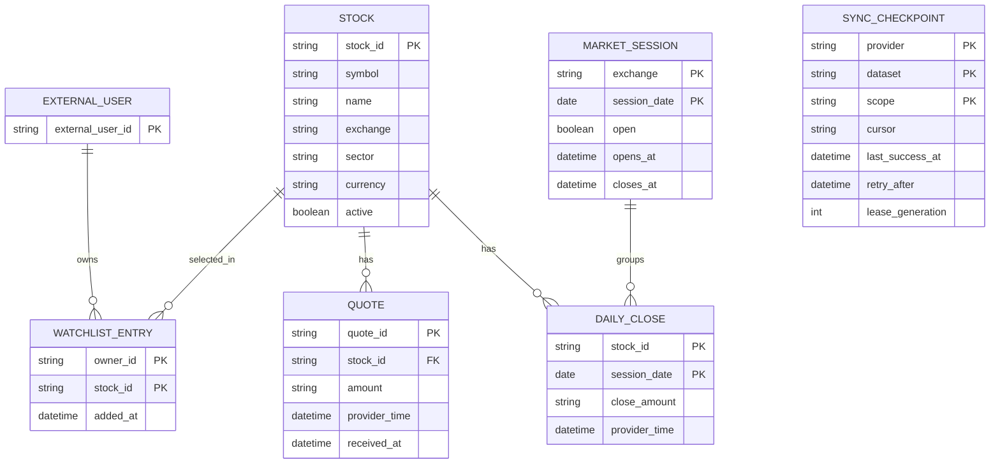

[README.md](https://github.com/user-attachments/files/34944016/README.md)
# Laboratorul 5 — Modelul datelor și proiectarea API-ului

**Disciplina:** Proiectarea sistemelor informatice  
**Student:** Marjina Lilian  
**Grupa:** InfA-241  
**Proiect:** Personal Investment Dashboard

## 1. Scop și cerințe de proiectare

Laboratorul descrie modelul logic al datelor și contractul REST al aplicației **Personal Investment Dashboard**, pornind de la domeniul stabilit în laboratoarele 1–4. Livrabilele sunt acest README (documentația `SOLUTION.md` cerută de temă este inclusă separat în `SOLUTION.md`), un fișier sursă FastAPI și `openapi.json` generat **din cod**, nu desenat manual.

Aplicația permite Overview, acțiuni în tendințe, Search, Filter, Stock detail, Price, History și Watchlist privat. Nu include tranzacționare, dețineri, profit/pierdere, SSE sau partajare. Toate exemplele bursiere sunt **date demonstrative, nu cotații actuale**.

### Legătura cu laboratoarele anterioare

| Laborator | Decizie păstrată | Impact în Lab 5 |
| --- | --- | --- |
| 1 — Product framing | Nasdaq, USD, acțiuni/ADR acceptate, Watchlist privat | Resurse `stocks`, `watchlist`; acțiunile inactive nu pot fi adăugate |
| 2 — Quality & estimates | Preț cu timp furnizor, până la 20 min în sesiune; p95 500 ms pentru Price, 2 s pentru alte citiri | `providerTime`, `status`, `ageSeconds`, paginare și erori explicite |
| 3 — Baseline architecture | Browser → Dashboard Application → date durabile; Collector separat de citirile utilizatorului | API pentru client, sincronizare internă, proprietar verificat pe server |
| 4 — Read-heavy path | Instanțe orizontale; L1 + Redis pentru date publice; citirile private nu sunt partajate | Același contract la toate instanțele, cache-ul nu este resursă expusă prin API |

**Clarificare privind identitatea:** identitatea autentificată este modelată ca entitate *externă* (`ExternalUser`); **nu există tabel local User sau API de login**. Sesiunea opacă este doar verificată de infrastructura Dashboard. Codul demonstrativ folosește o valoare fixă pentru a permite inspectarea documentației, nu un sistem de autentificare real.

## 2. Modelul logic al datelor

### 2.1. Entități și responsabilități

| Entitate | Identitate și scop | Relații / apartenență |
| --- | --- | --- |
| `Stock` | `stock_id`, instrumentul bursier stabil chiar dacă simbolul se modifică | Un Stock are multe cotații și închideri; poate apărea în Watchlist-uri diferite |
| `Quote` | `quote_id`, observație validată de preț la `provider_time` | Aparține unui singur Stock; mai multe observații în timp |
| `DailyClose` | `(stock_id, session_date)`, închiderea zilnică neajustată | Aparține unui singur Stock; maximum una acceptată per zi de sesiune, cu revizii validate |
| `MarketSession` | `(exchange, session_date)`, orele oficiale ale sesiunii | Calendar comun; prețurile sunt evaluate în contextul sesiunii |
| `WatchlistEntry` | `(owner_id, stock_id)`, apartenența unui Stock la lista privată | `owner_id` referă identitatea externă; nu se expune ca parametru client |
| `SyncCheckpoint` | `(provider, dataset, scope)`, stare colector | Progres intern, fără endpoint pentru browser |
| `ExternalUser` | Identitate de autentificare gestionată extern | Un utilizator poate deține zero sau mai multe intrări Watchlist |

### 2.2. Dicționarul câmpurilor stocate

Pentru fiecare câmp sunt indicate semnificația, un exemplu și regula pentru absență. Valorile stocate folosesc **snake_case**; schema HTTP folosește **camelCase**. Tipurile și indexurile SQL nu sunt obiectul acestui laborator.

| Entitate | Câmp stocat | Sens și exemplu | Regula pentru absență |
| --- | --- | --- | --- |
| Stock | `stock_id` | identificator stabil `stk-aapl` | obligatoriu |
| Stock | `symbol` | ticker `AAPL` | obligatoriu |
| Stock | `name` | nume `Apple Inc.` | obligatoriu |
| Stock | `exchange` | piață `NASDAQ` | obligatoriu |
| Stock | `sector` | sector `Technology` | `null` = necunoscut; nu se ghicește |
| Stock | `currency` | monedă `USD` | obligatoriu, singura acceptată în v1 |
| Stock | `active` | eligibil la căutare/adăugare `true` | obligatoriu; nu se presupune `true` dacă lipsește |
| Quote | `quote_id` | observație `q-20261116-aapl` | obligatoriu |
| Quote | `stock_id` | referință `stk-aapl` | obligatoriu |
| Quote | `amount` | preț decimal `187.50` | absența = cotație indisponibilă, nu zero |
| Quote | `currency` | `USD` | obligatoriu pentru cotație validă |
| Quote | `provider_time` | timp observație `2026-11-16T15:45:00Z` | fără timp valid, cotația nu este acceptată |
| Quote | `received_at` | timp ingestie `2026-11-16T16:01:00Z` | obligatoriu intern, nu înlocuiește timpul sursei |
| DailyClose | `stock_id` | instrument `stk-aapl` | obligatoriu |
| DailyClose | `session_date` | zi `2026-11-13` | obligatoriu |
| DailyClose | `close_amount` | închidere `186.30` | nu se creează rând dacă lipsește |
| DailyClose | `provider_time` | moment furnizor `2026-11-13T21:00:00Z` | obligatoriu pentru închiderea validată |
| MarketSession | `exchange` | `NASDAQ` | obligatoriu |
| MarketSession | `session_date` | `2026-11-16` | obligatoriu |
| MarketSession | `opens_at` | `2026-11-16T14:30:00Z` | `null` dacă este zi fără tranzacții |
| MarketSession | `closes_at` | `2026-11-16T21:00:00Z` | `null` dacă este zi fără tranzacții |
| MarketSession | `open` | zi cu sesiune `true` | obligatoriu; nu deduce programul din offset fix |
| WatchlistEntry | `owner_id` | identitate externă `user-demo-lilian` | obligatoriu, derivat din sesiune |
| WatchlistEntry | `stock_id` | selecție `stk-aapl` | obligatoriu |
| WatchlistEntry | `added_at` | confirmare `2026-11-16T16:05:00Z` | obligatoriu |
| SyncCheckpoint | `provider` | furnizor `market-provider` | obligatoriu |
| SyncCheckpoint | `dataset` | set `quotes` | obligatoriu |
| SyncCheckpoint | `scope` | acoperire `NASDAQ` | obligatoriu |
| SyncCheckpoint | `cursor` | poziție `batch-42` | `null` înainte de primul lot |
| SyncCheckpoint | `last_success_at` | `2026-11-16T16:02:00Z` | `null` dacă nu există succes |
| SyncCheckpoint | `retry_after` | `2026-11-16T16:03:00Z` | `null` dacă nu există amânare |
| SyncCheckpoint | `lease_generation` | versiune `9` | obligatoriu după inițializare; oprește lucrătorii vechi |

Valorile calculate **nu** sunt câmpuri autoritative stocate: `watchlistCount = numărul intrărilor utilizatorului`, `ageSeconds = now − providerTime`, `changePercent = (price − previousClose) / previousClose × 100`, `priceStatus` după calendar + vârstă, `nextCursor` construit din poziția paginii și filtre. Dacă lipsește închiderea anterioară sau prețul, schimbarea procentuală nu se inventează. Pentru `changePercent`, `previousClose` trebuie să fie pozitiv.

### 2.3. Diagrama Mermaid ER



`EXTERNAL_USER` este **o referință conceptuală**, nu un tabel local. `SYNC_CHECKPOINT` rămâne independent de entitățile publice: reprezintă starea jobului de sincronizare, nu conținutul unei cotații. `MarketSession` grupează închiderile pentru piața și data lor; potrivirea include `exchange` din Stock. Diagrama arată relațiile logice, nu implementarea cheilor SQL.

### 2.4. Reguli pentru actualitate și trending

- În sesiune normală, la **0–15 minute** de la `provider_time` se prezintă prețul cu avertismentul privind fluxul întârziat; la **peste 15 până la 20 minute** se marchează explicit „Delayed”; **peste 20 minute**, dată invalidă sau lipsă = „Unavailable”.
- După închiderea pieței se poate arăta ultima închidere confirmată și data sa, etichetată „Market closed”, cu excepțiile de tranziție din Lab 2. `received_at` ori `cached_at` nu întineresc cotația.
- **Trending** se ordonează după `changePercent` descrescător față de ultima închidere confirmată, apoi `symbol` ascendent, apoi `stockId` ascendent pentru egalitate. Sunt eligibile numai acțiunile active cu preț acceptabil și închidere anterioară pozitivă. Lipsa datelor exclude elementul din clasamentul numeric, nu îl clasifică drept 0%.
- Watchlist nu moștenește cache-ul public: conținutul se citește după verificarea identității și apartenenței; după un commit confirmat, următoarea citire trebuie să reflecte modificarea.

## 3. Inventarul endpoint-urilor REST

Baza ilustrativă este `https://dashboard.example`. Versiunea face parte din cale: **`/v1`**. Toate operațiile cer cookie-ul opac `dashboard_session`, verificat de server; `PUT` și `DELETE` cer suplimentar antetul `X-CSRF-Token`.

| Acțiune | Metodă și cale | Intrare | Succes | Acces |
| --- | --- | --- | --- | --- |
| Overview | `GET /v1/market/overview` | fără parametri | `200 Overview` | autentificat |
| Trending | `GET /v1/stocks/trending` | `limit`, `cursor` | `200 TrendingPage` | autentificat |
| Căutare și filtre | `GET /v1/stocks` | `q`, `exchange`, `sector`, `limit`, `cursor` | `200 StockPage` | autentificat |
| Stock detail | `GET /v1/stocks/{stock_id}` | identificator stabil | `200 StockDetail` | autentificat |
| Preț | `GET /v1/stocks/{stock_id}/price` | identificator stabil | `200 Price` | autentificat |
| Istoric | `GET /v1/stocks/{stock_id}/history` | `from`, `to`, `limit`, `cursor` | `200 HistoryPage` | autentificat |
| Citește Watchlist | `GET /v1/watchlist` | `limit`, `cursor` | `200 WatchlistPage` | proprietar din sesiune |
| Adaugă la Watchlist | `PUT /v1/watchlist/{stock_id}` | ID în cale, CSRF; corp gol | `200 WatchlistMutation` | proprietar, sesiune și CSRF |
| Elimină din Watchlist | `DELETE /v1/watchlist/{stock_id}` | ID în cale, CSRF; corp gol | `200 WatchlistMutation` | proprietar, sesiune și CSRF |

### 3.1. Parametri, validare și paginare

| Intrare | Regula stabilită |
| --- | --- |
| `stock_id` | obligatoriu, `stk-` + litere mici/cifre/cratimă, 3–80 caractere; cod `400` pentru format invalid |
| `q` | opțional, max 80 caractere; potrivire fără sensibilitate la majuscule după simbol/nume |
| `exchange` | opțional, numai `NASDAQ` în v1; altă valoare este `400`, nu un filtru ignorat |
| `sector` | opțional, max 50 caractere; necunoscut (`null`) nu se potrivește cu un sector numit |
| `limit` | implicit `20`, între `1` și `100` inclusiv la liste și Trending; pentru History implicit `100`, maxim `365` |
| `cursor` | opțional, max 200 caractere; opac, legat de filtru/sortare; invalid/expirat → `400` |
| `from`, `to` | date ISO calendaristice; `from ≤ to`; istoric în fereastra de șapte ani, ordonat descrescător după dată |

Paginarea folosește **keyset/cursor** stabil: `nextCursor` este token opac sau `null` dacă nu mai sunt rezultate. Pentru Search/Filter ordinea este `symbol`, apoi `stockId`; pentru Watchlist `addedAt` descrescător, apoi `stockId`. Un cursor reutilizat cu alți parametri este respins. Cache-ul public poate reține doar variațiile anonime ale acestor filtre; nu include sesiunile sau Watchlist-ul.

### 3.2. Contracte JSON — exemple concrete

**Pagină de acțiuni filtrată:** `GET /v1/stocks?exchange=NASDAQ&sector=Technology&limit=2`

```json
{
  "items": [
    {"stockId":"stk-aapl","symbol":"AAPL","name":"Apple Inc.","exchange":"NASDAQ","sector":"Technology","currency":"USD","active":true},
    {"stockId":"stk-msft","symbol":"MSFT","name":"Microsoft Corporation","exchange":"NASDAQ","sector":"Technology","currency":"USD","active":true}
  ],
  "nextCursor": null
}
```

**Rezultat gol, nu eroare:** `GET /v1/stocks?sector=Energy`

```json
{"items":[],"nextCursor":null}
```

**Trending:** `GET /v1/stocks/trending?limit=1` — clasament demonstrativ, nu valori curente.

```json
{
  "items": [
    {
      "stock":{"stockId":"stk-aapl","symbol":"AAPL","name":"Apple Inc.","exchange":"NASDAQ","sector":"Technology","currency":"USD","active":true},
      "changePercent":"2.40",
      "previousClose":"183.11"
    }
  ],
  "nextCursor":null,
  "sort":"change_desc"
}
```

**Detalii Stock:** `GET /v1/stocks/stk-aapl`

```json
{
  "stock":{"stockId":"stk-aapl","symbol":"AAPL","name":"Apple Inc.","exchange":"NASDAQ","sector":"Technology","currency":"USD","active":true},
  "price":{"stockId":"stk-aapl","amount":null,"currency":"USD","providerTime":"2026-11-16T15:45:00Z","status":"unavailable","ageSeconds":null}
}
```

**Cotație:** `GET /v1/stocks/stk-aapl/price` întoarce obiectul `price` de mai sus. Timpul istoric din exemplu nu autorizează prezentarea prețului ca fiind curent. `amount:null` este diferit de `"0"`.

**Istoric:** `GET /v1/stocks/stk-aapl/history?from=2026-11-12&to=2026-11-13&limit=100`

```json
{"stockId":"stk-aapl","priceBasis":"unadjusted_daily_close","items":[{"sessionDate":"2026-11-13","close":"186.30"},{"sessionDate":"2026-11-12","close":"185.40"}],"nextCursor":null}
```

**Watchlist gol:** `GET /v1/watchlist`

```json
{"items":[],"nextCursor":null}
```

**Mutarea Watchlist:** `PUT /v1/watchlist/stk-aapl` sau `DELETE /v1/watchlist/stk-aapl` cu `X-CSRF-Token`, fără `ownerId`, `addedAt` sau orice câmp controlat de server în corp. După commit durabil, răspunsurile proiectate sunt:

```json
{"stockId":"stk-aapl","added":true}
```

```json
{"stockId":"stk-aapl","added":false}
```

**Important:** în implementarea demonstrativă operațiile de scriere întorc `503 persistence_not_implemented`, deoarece nu există o bază durabilă; exemplul `200` descrie **contractul proiectat**, nu un commit simulat ca reușit. Un `PUT` repetat este idempotent, iar `DELETE` pentru o intrare deja absentă păstrează absența. Adăugarea unui instrument inactiv se respinge; eliminarea unuia inactiv rămâne permisă.

**Eroare unică JSON:** exemplu de limită invalidă: `GET /v1/stocks?limit=300` produce `400`.

```json
{"error":{"code":"invalid_parameter","message":"Parametri sau corp JSON invalide"}}
```

| Cod | Semnificație | Comportament client |
| --- | --- | --- |
| `200` | citire/mutare confirmată | afișează rezultatul |
| `400` | parametri invalizi, cursor incompatibil | corectează cererea, fără retry automat |
| `401` | sesiune absentă/expirată | autentificare din nou |
| `403` | CSRF sau acțiune nepermisă | respinge, fără scurgere de date private |
| `404` | Stock necunoscut sau resursă privată invizibilă | același răspuns pentru absent și străin |
| `429` | prea multe cereri | respectă `Retry-After`, backoff cu jitter și fără retry sincron în rafală |
| `503` | sursă indisponibilă sau commit neconfirmat | mesaj explicit, nu rezultat gol inventat |

Eroarea `429` poate include antetul `Retry-After` în secunde; clientul așteaptă cel puțin acest interval și nu generează rafale de reîncercări. Instanțele Dashboard folosesc reguli comune de limitare pentru a nu ocoli limita când distribuirea traficului se schimbă.

### 3.3. Politici API și integrarea Collector-ului

- **Versiune:** `/v1` în calea URL. Adăugarea unui câmp *opțional* de răspuns este compatibilă. Redenumirea sau eliminarea `stockId`, schimbarea sensului lui `amount`, ori schimbarea formei erorilor este incompatibilă și cere `/v2`.
- **Autentificare:** cookie `dashboard_session` opac, `Secure`, `HttpOnly`, `SameSite`, verificat la fiecare cerere; protecție CSRF la modificări. Identitatea externă se rezolvă **pe server**. În exemplul FastAPI, valorile `demo-session` și `demo-csrf` sunt mock-uri, nu se folosesc în producție.
- **Confidențialitate:** niciun `ownerId` de la client; toate citirile și mutările private filtrează după identitatea verificată. Nu se partajează răspunsurile Watchlist în Redis/L1 între utilizatori.
- **Collector:** integrează server-to-server cu Market Data Provider și actualizează `Stock`, `Quote`, `DailyClose`, `MarketSession`, `SyncCheckpoint`; nu există endpoint pentru browser de tip `/sync` sau `/cache`.
- **Latență și consistență:** deadline de citire 2 secunde, politică de prospețime din Lab 2, fără refresh direct de la Provider pentru fiecare cerere. Citirile Watchlist după mutare confirmată merg la starea autoritativă, nu la o replică întârziată.

## 4. Generarea și verificarea OpenAPI

Fișierele din această predare:

```text
lab-5/
├── README.md
├── SOLUTION.md
├── app.py
├── generate_openapi.py
├── requirements.txt
├── openapi.json
└── assets/
    └── openapi-inspection.html
```

Codul `app.py` conține **9 operații pe 8 căi**, modelele Pydantic cu validare, exemple și răspunsuri de eroare; `generate_openapi.py` produce `openapi.json` prin `app.openapi()` (FastAPI). Nu am scris manual schema rezultată.

```bash
python -m pip install -r requirements.txt
python generate_openapi.py
uvicorn app:app --reload
```

Documentația interactivă FastAPI: `http://127.0.0.1:8000/docs`; contractul brut: `http://127.0.0.1:8000/openapi.json`. Fișierul generat poate fi deschis și în [Swagger Editor](https://editor.swagger.io/). URL-ul `https://dashboard.example` este doar o adresă ilustrativă.

**Vizualizarea locală:** [assets/openapi-inspection.html](assets/openapi-inspection.html) enumeră operațiile și câteva exemple pe baza documentului generat. Pentru captura cerută de profesor, deschide `openapi.json` în Swagger Editor și salvează o captură a verificării. Captura nu a putut fi creată automat în acest mediu.

### Verificări făcute pe contractul demonstrativ

| Test | Rezultat verificat |
| --- | --- |
| `GET /v1/stocks/trending` cu sesiune demo | `200`, `items` cu un instrument și regulă `sort` |
| `GET /v1/stocks?sector=Energy` cu sesiune demo | `200`, `items: []`, `nextCursor: null` |
| `GET /v1/stocks/stk-aapl/price` cu sesiune demo | `200`, `amount: null`, `status: unavailable` |
| `GET /v1/stocks?limit=300` cu sesiune demo | `400`, structură uniformă `error` |
| `GET /v1/watchlist` fără cookie | `401` |
| `PUT /v1/watchlist/stk-aapl` cu sesiune + CSRF demo | `503` intenționat, deoarece persistența nu este implementată |

**Limitare declarată:** fixture-urile publice sunt de demonstrație, iar loginul și commit-ul real nu sunt implementate. Endpoint-urile din sursă documentează contractul, dar **nu constituie un backend conectat la Market Data Store sau la furnizor**.

## 5. Fluxul complet al clientului

Scenariul cerut: **Open trending Stocks → open one Stock for more market data → add it to Watchlist**. Baza: `https://dashboard.example`; cookie valid `dashboard_session=...`; la scriere se folosește și protecția CSRF.

| Pas | Cerere | Răspuns relevant | Stare UI |
| --- | --- | --- | --- |
| 1 | `GET /v1/stocks/trending?limit=20` | `200 TrendingPage` cu `stk-aapl` | spinner → listă de tendințe |
| 2 | `GET /v1/stocks/stk-aapl` | `200 StockDetail` | nume și cotație etichetată |
| 3 | `GET /v1/stocks/stk-aapl/price` | `200 Price` | preț și timp, sau mesaj „Unavailable” |
| 4 | `GET /v1/stocks/stk-aapl/history?limit=100` | `200 HistoryPage` | graficul închiderilor disponibile |
| 5 | `PUT /v1/watchlist/stk-aapl` + `X-CSRF-Token` | `200` **numai după commit**, altfel eroare explicită | buton „Added” doar după confirmare |
| 6 | `GET /v1/watchlist` | `200 WatchlistPage`, citire autoritativă | confirmă apartenența într-o citire nouă |

**Exemple de mesaje HTTP:**

```http
GET /v1/stocks/trending?limit=20 HTTP/1.1
Host: dashboard.example
Cookie: dashboard_session=<opaque-session>
Accept: application/json
```

```http
GET /v1/stocks/stk-aapl/price HTTP/1.1
Host: dashboard.example
Cookie: dashboard_session=<opaque-session>
```

```http
GET /v1/stocks/stk-aapl/history?limit=100 HTTP/1.1
Host: dashboard.example
Cookie: dashboard_session=<opaque-session>
```

```http
PUT /v1/watchlist/stk-aapl HTTP/1.1
Host: dashboard.example
Cookie: dashboard_session=<opaque-session>
X-CSRF-Token: <csrf-token>
Content-Length: 0
```

Răspunsurile JSON pentru toate aceste etape sunt cele din secțiunea 3.2. Pentru accesul la Stock details, `StockDetail` include și prețul; pasul 3 este păstrat explicit pentru actualizarea independentă a panoului Price, conform separării celor șase citiri din Lab 2.

**UI:** în timpul încărcării folosește schelet/spinner; la succes afișează identitate, marcaj temporal, status și istoric neajustat; o listă goală arată „Nicio acțiune găsită” sau „Watchlist gol”; la 401 cere autentificare, la 429 respectă `Retry-After`, la 503 afișează „Date indisponibile”, fără preț zero sau succes fals. Dacă adăugarea nu poate fi confirmată, butonul rămâne neconfirmat și utilizatorul poate reîncărca Watchlist-ul.

## 6. Concluzii și verificarea cerințelor

| Cerință Lab 5 | Livrabil |
| --- | --- |
| Entități cu sens, câmpuri, lipsuri și relații | secțiunea 2 și diagrama ER |
| Identitate externă, proprietate privată | `ExternalUser` logic, fără tabel local de cont |
| Endpoint-uri, validare, liste, erori, politici | secțiunea 3 și modelele `app.py` |
| OpenAPI generat din cod | `generate_openapi.py` → `openapi.json` |
| Vizualizare și verificare contract | `assets/openapi-inspection.html` și teste din secțiunea 4; captura Swagger Editor rămâne de adăugat |
| Flux client Trending → Details → Watchlist | secțiunea 5 |

Modelul distinge datele durabile de valorile calculate, păstrează sursa și timpul cotațiilor, iar API-ul separă datele publice de Watchlist-ul privat. Codul este un prototip de contract, cu stubs declarate pentru operațiile ce necesită persistență reală.

## 7. Referințe

- [Cerințele Laboratorului 5](../../labs/05-domain-data-model/README-ro.md)
- [Lecția 6 — Modelarea datelor, proiectarea API-urilor și OpenAPI](../../lectures/lecture-06-api-design-and-data-modeling-ro.md)
- [FastAPI — First Steps](https://fastapi.tiangolo.com/tutorial/first-steps/)
- [OpenAPI — Specification](https://spec.openapis.org/oas/latest.html)
